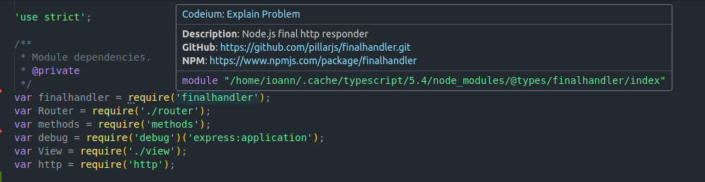

# Package Info

Packageobligatory Info

Access package information directly in your code editor with Package Info. This lightweight VS Code extension provides instant package details when you hover over imports, streamlining your development workflow.

## Features
- **Hover Information**: View concise package descriptions on hover.
- **Quick Links**: Access npm or GitHub pages for further documentation.
- **Supported Languages/Frameworks**:
  - JavaScript
  - JavaScript React
  - TypeScript
  - TypeScript React
  - Python
  - Svelte (framework)
  - Vue (framework)
  - JSON

## How to Use
1. Open a file in a supported language or framework.
2. Hover over `require(...)` or `import from '...'` statements to view package details.

## Installation
1. Install from the VS Code Marketplace.
2. Ensure VS Code version 1.94.0 or higher.
3. The extension activates automatically for supported languages/frameworks.

## Contributing
Report bugs or suggest features at [GitHub](https://github.com/IoannP/package-info).

## License
MIT